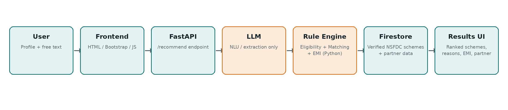

# GaneshNiti — AI-assisted NSFDC Scheme Navigator

> Smart India Hackathon 2026 · PS26092 (PS92) · Team GaneshNiti

An AI-assisted web app that helps Scheduled Caste entrepreneurs and students find the right NSFDC credit scheme, see **exactly why** they are or aren't eligible, estimate their real repayment figure, and find a Channel Partner to apply through — without needing to understand government scheme jargon first.

   **Live demo:** https://ganeshniti.onrender.com (free hosting: the first visit after a quiet period can take up to a minute to wake up)

**Core principle: AI understands the person; verified rules decide eligibility.**
The LLM never decides who qualifies. It only turns a plain-language description into structured data. Deterministic, unit-tested Python rules decide eligibility using NSFDC's own published numeric criteria, and every decision comes with a numeric trace (your value vs. the scheme's limit, pass/fail).

---

## How it works



1. The user fills a short profile (category, state, income, business type, amount, new/existing) and optionally describes their need in their own words.
2. The backend sends the free text to an LLM (OpenRouter) which returns structured fields — nothing more. If the call fails, returns invalid data, or no API key is set, the system falls back to the form fields the user already typed.
3. Verified scheme data (researched from official sources, each record carries a source URL and last-verified date) is checked against the profile by plain Python rules, producing a **numeric trace** per rule.
4. Eligible schemes are ranked by **financing fit** (loan-size suitability, purpose match), a **quarterly repayment** figure is calculated for the top match (NSFDC repays quarterly), and a matching Channel Partner is suggested.
5. The frontend shows why each scheme matched or didn't, the repayment, the documents to keep ready, and a link to the official source.

## Key design decisions

| Decision | Why | Trade-off |
|---|---|---|
| Rules decide eligibility, not the LLM | A loan-eligibility answer must be auditable and reproducible; LLMs can hallucinate | Rules need manual upkeep when a scheme changes |
| LLM output is schema-validated, with fallback to form fields | A broken LLM call must never block a recommendation | Free-text only improves results; it isn't required |
| Firestore with a local-JSON fallback | Shallow relational needs; the app also runs with zero cloud setup | Two copies of data to keep in sync (the spreadsheet is the source of truth; `data/upload_schemes.py` mirrors it) |
| One FastAPI process serves API and frontend | One deployment, no CORS, no hard-coded backend URL | Frontend and backend scale together (fine at this size) |
| Quarterly (not monthly) repayment | That is how NSFDC schemes repay | — |

## What is real vs. simulated

- **Scheme data is real**, verified against nsfdc.nic.in, NSFDC policy documents and PIB releases.
- **Channel Partner data is simulated** — live partner availability and NPA data are not public. The UI labels it as simulated.
- This is a prototype. Results are guidance, not a loan decision; always confirm on the official source link.

## Tech stack

| Layer | Technology |
|---|---|
| Frontend | HTML, Bootstrap, vanilla JavaScript |
| Backend | Python, FastAPI |
| Database | Firebase Firestore, with local JSON fallback |
| AI | LLM via OpenRouter (language understanding only) |
| Eligibility, matching, repayment | Plain Python — deterministic, unit-tested, no ML |
| Delivery | Docker, Render, GitHub Actions CI |

## Quick start (no accounts needed)

```bash
cd backend
pip install -r requirements.txt
uvicorn main:app --reload
```

Open <http://127.0.0.1:8000>. The same server serves the frontend and the API, so nothing else to configure. Without `OPENROUTER_API_KEY` the app still works using the form fields.

Call the API directly:

```bash
curl -X POST http://127.0.0.1:8000/recommend \
  -H "Content-Type: application/json" \
  -d '{"category":"SC","state":"Maharashtra","annualIncome":280000,"businessType":"tailoring","amountRequired":120000,"isNewBusiness":false,"requirement":"I need money for sewing machines"}'
```

Interactive API docs: <http://127.0.0.1:8000/docs>

### Optional: free-text understanding

Create `backend/.env`:

```
OPENROUTER_API_KEY=your-key
```

### Optional: use real Firestore

1. Create a Firebase project → Firestore Database → Service Accounts → *Generate new private key*.
2. Save it as `backend/serviceAccountKey.json` (gitignored), **or** set `FIREBASE_CREDENTIALS_JSON` to the key's contents on a host that can't hold files.
3. Upload the verified data: `cd data && pip install firebase-admin openpyxl && python upload_schemes.py --dry-run` (preview), then `python upload_schemes.py`.
4. `GET /schemes` should report `"source": "firestore"`.

To refresh the local fallback JSON after editing the spreadsheet: `cd data && python upload_schemes.py --dry-run` (writes into `backend/data/`).

## Tests

```bash
cd backend
pip install -r requirements-dev.txt
pytest tests -v
```

Covers the eligibility engine (including numeric traces), matching/ranking, repayment calculator, partner locator, and an HTTP-level smoke test of `/recommend`. CI runs them on every push.

## Deploy

**Render (free tier, recommended):** push this repo → Render → *New* → *Blueprint* → select the repo. `render.yaml` and the `Dockerfile` do the rest. Optionally add `OPENROUTER_API_KEY` in the dashboard. The free tier sleeps when idle, so the first request after a pause takes about 30–60 seconds.

**Anywhere with Docker:**

```bash
docker build -t ganeshniti .
docker run -p 8000:8000 -e OPENROUTER_API_KEY=... ganeshniti
```

**Frontend on GitHub Pages instead:** set `window.GANESHNITI_API_BASE` in `frontend/js/config.js` to your API URL, and set `ALLOWED_ORIGINS` on the API to your Pages origin.

## Project structure

```
backend/
  main.py                    FastAPI app: API + serves the frontend
  routers/                   schemes.py (GET /schemes, /channel-partners), recommend.py (POST /recommend)
  services/
    eligibility_engine.py    deterministic checks + numeric trace
    matching_engine.py       financing-fit ranking
    emi_calculator.py        quarterly repayment
    llm_extraction.py        OpenRouter call + validation + fallback
    firestore_client.py      Firestore reads with local-JSON fallback
    partner_locator.py       Channel Partner matching (simulated data)
  data/                      verified scheme + simulated partner JSON (fallback copy)
  tests/                     pytest suites
frontend/                    index / profile / results pages, js/app.js, js/config.js
data/                        PS92_Scheme_Research.xlsx (source of truth) + upload_schemes.py
Dockerfile, render.yaml      deployment
.github/workflows/           ci.yml (tests), deploy.yml (optional Pages frontend)
```

## Limitations and next steps

- Scheme rules were transcribed from official documents; they must be re-verified when NSFDC revises criteria.
- Several limits are non-numeric in the source ("no income ceiling", "not fixed") and are stored as `null` with a `...Raw` text field; the engine treats `null` as "no numeric limit".
- Free-text input is English-oriented; multilingual input is the obvious next step.
- No user accounts or stored profiles by design (no personal data is persisted).

## Team

| Role | Focus |
|---|---|
| Backend Lead | Eligibility engine, matching engine, repayment calculator |
| Backend / Data | Firestore, LLM extraction, Channel Partner locator |
| Frontend Lead | Profile form, fetch logic |
| Frontend / UI | Results page, scheme cards, styling |
| Data / QA | Scheme data verification, testing, demo validation |
| Documentation / Presentation | README, architecture diagram, slides, demo script |

My contribution:** Team lead and backend developer (Python / FastAPI). I worked on the backend of the eligibility and recommendation flow and coordinated the team._
